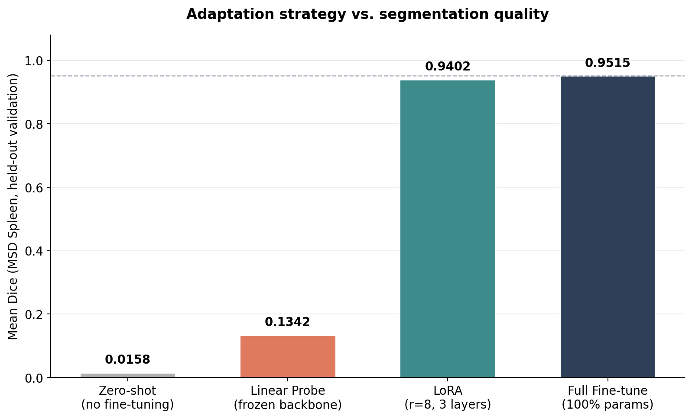
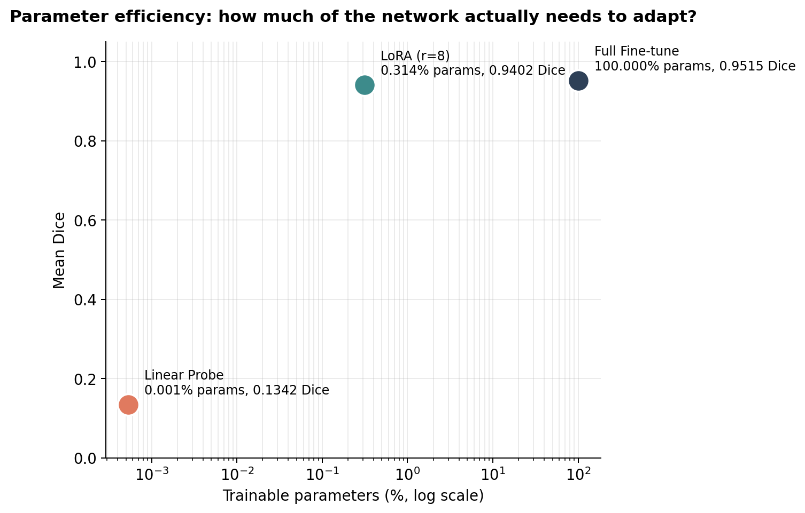
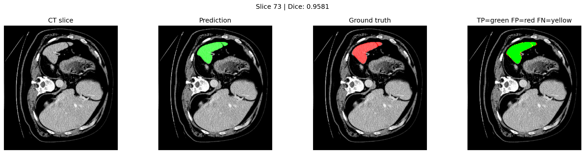

# UNETR-pp-PEFT: Adapting a Pretrained Segmentation Transformer to a Data-Scarce Medical Imaging Task


> Investigating whether a segmentation transformer pretrained on 13 abdominal organs can be efficiently adapted to a new, data-scarce single-organ task — without training from scratch.

## Overview

State-of-the-art 3D Vision Transformers like **UNETR++** use an efficient paired spatial-and-channel attention mechanism to achieve highly accurate volumetric segmentation. But these architectures are expensive to train from scratch and hungry for labeled data — resources most real clinical settings simply don't have. *(Full architectural details: [UNETR++: Delving into Efficient and Accurate 3D Medical Image Segmentation, Shaker et al., IEEE TMI 2024](https://arxiv.org/abs/2212.04497).)*

This repository explores a concrete version of that constraint: **can a 3D segmentation transformer pretrained on a 13-organ CT dataset (Synapse) be adapted to a new, single-organ target using a severely limited data budget and modest hardware — hardware a hospital, or a single researcher, could actually access?**



## Phase 1 — Full Fine-Tuning Baseline

By achieving >0.95 Dice on just 33 training patients, this phase establishes that the Synapse-pretrained weights transfer effectively to spleen — a strong ceiling to measure every subsequent, cheaper strategy against.

| | |
|---|---|
| **Backbone** | UNETR++, pretrained on Synapse (13-organ abdominal CT) |
| **Target task** | MSD Spleen (Task09_Spleen) — 41 CT volumes, single organ, binary segmentation |
| **Adaptation strategy** | Full fine-tuning (all backbone weights + freshly initialized 2-class output heads) |
| **Data split** | 33 train / 8 validation |
| **Best Mean Dice** | **0.9515** |

For reference, this matches a fully-converged CNN U-Net trained from scratch on this dataset (per MONAI's own Spleen tutorial), achieved here with a fraction of the domain-specific data.

## Phase 2 — Parameter-Efficient Fine-Tuning (LoRA)

To test whether full fine-tuning's cost is actually necessary, Phase 2 implements a **custom Low-Rank Adaptation (LoRA)** wrapper, injecting trainable rank-decomposition matrices directly into UNETR++'s attention blocks while freezing the rest of the network.

| | |
|---|---|
| **Adaptation strategy** | Custom LoRA (rank = 8) injected into `qkvv`, `out_proj`, and `out_proj2` |
| **Frozen parameters** | ~43,086,638 (CNN stem, transformer encoder/decoder, all BatchNorm statistics) |
| **Trainable parameters** | 135,398 (LoRA matrices + freshly initialized output heads) — **0.31%** of the network |
| **Best Mean Dice** | **0.9402** |



*Takeaway: training 0.31% of the network recovers Dice within ~0.01 of full fine-tuning. One honest caveat worth stating plainly: spleen is not a novel organ to this backbone — it's one of Synapse's own 13 pretrained classes, chosen deliberately as a controlled validation task with a known ceiling to measure against. This result demonstrates that Synapse's pretrained features transfer efficiently to a related, data-scarce task; it does not yet demonstrate generalization to a genuinely unseen organ — that's the next planned experiment (see Roadmap).*


## Fine-Tuning Pipeline

- **Exact key accounting** — the model contains 636 total parameter/buffer tensors. Exactly 6 belong to the three multi-resolution output heads, freshly initialized for 2 classes instead of Synapse's original 13. The remaining 630 backbone tensors matched the checkpoint by name and shape with zero exceptions, confirmed by explicit programmatic audit.
- **MONAI-based 3D data pipeline** — intensity windowing, foreground-aware cropping, anisotropic spacing normalization, and positive/negative-balanced patch sampling (`RandCropByPosNegLabeld`) for a small, class-imbalanced dataset.
- **Deep-supervision shape alignment** — UNETR++'s 3 auxiliary output heads sit at different decoder resolutions; `monai.losses.DeepSupervisionLoss` correctly downsamples the ground truth per scale rather than naively comparing mismatched resolutions.
- **Custom LoRA wrapper** (`peft_methods/lora.py`) — targets `qkvv`, `out_proj`, and `out_proj2` by direct module reference rather than by name, since UNETR++'s fused-attention design has no separately-named query/key/value layers for off-the-shelf PEFT tooling to target.
- **Zero-latency deployment path** — `LoRALinear.merge()` folds trained LoRA matrices directly into the frozen base weights, producing an architecture identical to the original network for inference, with no added latency.
- **Automated run tracking** — every run writes a timestamped `runs/` directory containing its exact config, training log, TensorBoard metrics, and a fully resumable checkpoint (optimizer, scheduler, scaler, and RNG state included).

## Sample Results



## Repository Structure

```text
.
├── configs/
│   └── config.yaml
├── data/
│   └── dataset.py
├── unetr_pp/                     # UNETR++ model (adapted from official repo)
├── peft_methods/                 # PEFT technique implementations
│   ├── freezing.py               # shared freeze + BatchNorm-eval logic
│   └── lora.py                   # custom LoRA wrapper for fused attention
├── utils/
│   ├── config.py
│   └── model_utils.py
├── train.py
├── test.py                       # inference + labeled comparison image export
└── runs/
```

## Setup

1. Clone the repository and install dependencies:
    ```bash
    pip install -r requirements.txt
    ```
2. Download the **MSD Spleen** dataset (Task09_Spleen) from the [Medical Segmentation Decathlon](http://medicaldecathlon.com/).
3. Download the official **Synapse-pretrained UNETR++ checkpoint** from the [official repository](https://github.com/Amshaker/unetr_plus_plus).
4. Update `data_dir` and `weights_path` in `configs/config.yaml`.

## Usage

**Train:**
```bash
python train.py
```
Set `peft.method` in `config.yaml` to `full_finetune`, `linear_probe`, or `lora`. Logs, the best checkpoint, and a fully resumable checkpoint are written to `runs/<timestamp>_<run_name>/`.

**Test and generate comparison images:**
```bash
python test.py --checkpoint runs/<run>/best_model_weights.pth --num_samples 3
```
Runs inference on held-out validation volumes (or any arbitrary NIfTI file via `--image_path`) and saves labeled CT / prediction / ground-truth / error-map panels to `test_outputs/`.

## Roadmap

- **Genuine novel-organ generalization test** — the current LoRA result validates efficient transfer to a *related* task (spleen is already one of Synapse's 13 pretrained organs). The next experiment targets an organ genuinely absent from Synapse's class list to test whether this adaptation approach generalizes beyond re-deriving something the backbone already implicitly knew.
- Lightweight FastAPI + UI deployment demonstrating hospital-side fine-tuning at low compute cost.

## Acknowledgments

This project builds on the official [UNETR++ implementation](https://github.com/Amshaker/unetr_plus_plus) (Apache License 2.0) by Shaker et al., and uses the [MONAI](https://project-monai.github.io/) framework for data loading, losses, and inference. Dataset: [Medical Segmentation Decathlon](http://medicaldecathlon.com/), Task09_Spleen.