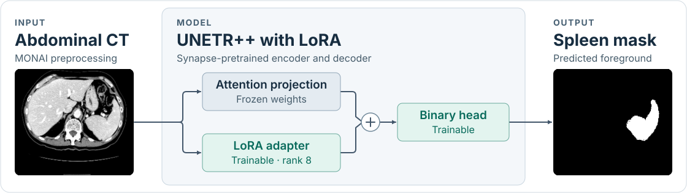
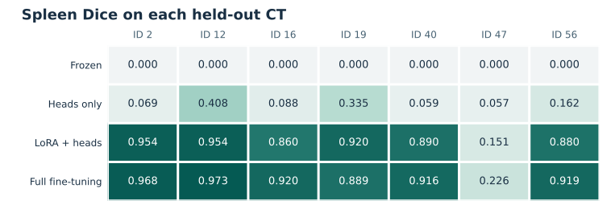
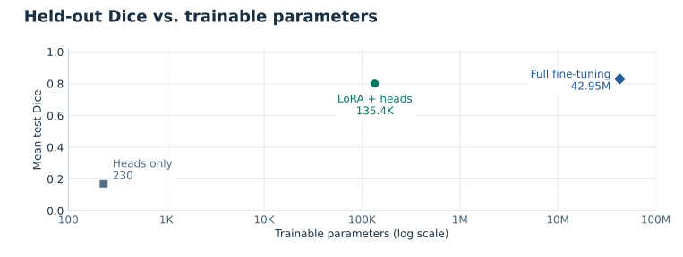
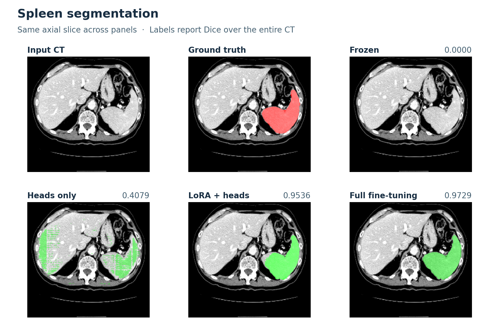

# Adapting UNETR++ with LoRA for spleen segmentation


[](configs/splits/msd_spleen.json)
[](#training-cost)

## Overview

**You have the pretrained weights, but not the exact preprocessing recipe. Can you still put the checkpoint to work without fine-tuning the whole model?**

UNETR++ pairs spatial and channel attention to segment organs in 3D images. Its checkpoint was trained to recognize 13 organs, including the spleen, on abdominal CT scans from the Synapse dataset. Yet when I applied the frozen model to spleen scans from the Medical Segmentation Decathlon (MSD) using standard MONAI preprocessing pipeline, its predictions missed the organ. The original model code points to another project for preprocessing, which makes the exact training recipe difficult to reproduce.

I built a **Low-Rank Adaptation (LoRA)** wrapper for UNETR++’s attention layers to test whether the pretrained model could segment the spleen with our preprocessing pipeline. I trained the adapters alongside the output heads and compared the results with heads-only training and full fine-tuning.

**Model reference:** Shaker et al., [*UNETR++: Delving into Efficient and Accurate 3D Medical Image Segmentation*](https://arxiv.org/abs/2212.04497), IEEE Transactions on Medical Imaging, 2024.

## Contents

| Explore the experiments | Use the repository |
|---|---|
| [Experiment design](#experiment-design) | [Repository guide](#repository-guide) |
| [Segmentation results](#segmentation-results) | [Setup](#setup) |
| [Training cost](#training-cost) | [Training and inference commands](#training-and-inference-commands) |
| [Sample predictions](#sample-predictions) | [Acknowledgments](#acknowledgments) |

## Experiment design

The **backbone** extracts features from the CT, and the **output heads** turn those features into segmentation masks. All four strategies use the same pretrained backbone weights as their starting point. Keeping MONAI preprocessing fixed lets us compare which weights need to learn. Identifying the effect of a specific transform, such as orientation or intensity scaling, would require varying it separately.

| Strategy | What learns? | What it tells us |
|---|---|---|
| Frozen checkpoint | Nothing. Take the spleen class from the original multiclass prediction. | How well do the published weights transfer directly under preprocessing mismatch? |
| Heads only | Three new binary segmentation heads; the backbone stays frozen. | Are the pretrained features already sufficient? |
| LoRA + heads | The same heads plus rank-8 adapters in the attention projections. | What does adapting attention add beyond the heads? |
| Full fine-tuning | The binary heads and all backbone weights. | What accuracy and training cost come with updating everything? |

The [custom wrapper](peft_methods/lora.py) adds a low-rank update to UNETR++’s fused attention projection (`qkvv`) and both output projections (`out_proj`, `out_proj2`). The original projection weights stay frozen during LoRA training.



<!-- ### Shared training and evaluation pipeline

- **Data:** One [patient split](configs/splits/msd_spleen.json) and one [MONAI preprocessing pipeline](data/dataset.py) for the 41 labeled MSD Spleen CTs.
- **Deep supervision:** During fine-tuning, the full-resolution head and two auxiliary heads learn from spleen masks at their respective resolutions.
- **Evaluation:** Sliding-window inference produces a full-volume mask. We compute spleen Dice on the preprocessed grid for each patient, then report the patient mean. -->

## Segmentation results

The first experiments used 33 patients for training and 8 for validation, with none reserved for testing. The second split set aside 7 patients for a final evaluation and used 6 others to select checkpoints. **The final column compares methods on the same seven unseen patients.**

**Table 1 · Mean spleen Dice by patient split** (higher is better)

| Strategy | 33 train / 8 validation<br>Validation Dice | 28 train / 6 validation / 7 test<br>Validation Dice | 28 train / 6 validation / 7 test<br>Test Dice |
|---|---:|---:|---:|
| Frozen checkpoint | — | 0.0000 | 0.0000 |
| Heads only | — | 0.1540 | 0.1681 |
| LoRA + heads | 0.9402 | 0.9191 | 0.8012 |
| Full fine-tuning | 0.9515 | 0.9632 | **0.8301** |


<!-- 

Adding LoRA to the binary heads improved mean test Dice by **0.6331** and improved overlap on all seven patients. LoRA + heads finished **0.0289** below full fine-tuning. Both scored lower on test than on validation, with their lowest Dice on the same scan (`spleen_47`). -->

## Training cost

LoRA + heads trained **135.4K parameters** against **42.95M** for full fine-tuning. That is **99.68% fewer trainable parameters** and **2.81 GiB less peak training memory** on the same workload.

**Table 2 · Trainable parameters and training cost**

| Strategy | Trainable / total parameters | Train step (ms) | Peak training memory (GiB) |
|---|---:|---:|---:|
| Frozen checkpoint | 0 / 42.95M (0%) | N/A | N/A |
| Heads only | 230 / 42.95M (0.00054%) | 409.1 | 1.87 |
| LoRA + heads | 135.4K / 43.09M (0.31%) | 913.6 | 8.17 |
| Full fine-tuning | 42.95M / 42.95M (100%) | 1,149.8 | 10.98 |



Training was measured on a **Tesla T4** with FP16 autocast and eight patches per optimizer step. Times are medians, and memory is peak GPU memory allocated by PyTorch. N/A means no training step.

## Sample predictions



Red marks the reference spleen and green marks each prediction. On this slice, heads only also marks tissue outside the spleen, while LoRA + heads and full fine-tuning follow the reference more closely. Each score is the Dice for the entire 3D scan.

## Repository guide

```text
configs/          Training and patient split presets
data/             MSD loaders and MONAI transforms
unetr_pp/         UNETR++ backbone, attention blocks, and decoder
peft_methods/     LoRA wrapper and parameter-freezing rules
scripts/          Training and inference entry points
utils/            Checkpoint handling, Dice reporting, and compute profiling
runs/             Saved configs, splits, checkpoints, and TensorBoard logs
```

## Setup

1. Clone the repository and install dependencies:
    ```bash
    pip install -r requirements.txt
    ```
2. Download the **MSD Spleen** dataset (Task09_Spleen) from the [Medical Segmentation Decathlon](http://medicaldecathlon.com/).
3. Download the official **Synapse-pretrained UNETR++ checkpoint** from the [official repository](https://github.com/Amshaker/unetr_plus_plus).
4. In your chosen [training preset](configs/training/), set `paths.data_dir` to the MSD folder containing `imagesTr/` and `labelsTr/`, and `paths.weights_path` to the Synapse checkpoint.

## Training and inference commands

Run from the repository root. Each training run saves its config, patient split, and best checkpoint together. To reproduce the 28/6/7 runs in the tables, set `learning_rate: 0.005`, `batch_size: 2`, and `max_epochs: 300` under `training` in each preset.

| Train or monitor | Command |
|---|---|
| Heads only | `python -m scripts.train --config configs/training/heads_only.yaml --profile` |
| LoRA + heads | `python -m scripts.train --config configs/training/lora.yaml --profile` |
| Full fine-tuning | `python -m scripts.train --config configs/training/full_finetune.yaml --profile` |
| View loss curves, validation Dice, and preprocessing previews | `tensorboard --logdir runs` |

For trained models, set `RUN` to the run directory and `CKPT="$RUN/best_model_weights.pth"`.

| Evaluate or predict | Command |
|---|---|
| Frozen checkpoint on the seven test patients | `python -m scripts.infer_frozen --config configs/training/heads_only.yaml --split test --output_dir outputs/frozen/test_7` |
| Trained checkpoint on its saved test split | `python -m scripts.infer_finetuned --checkpoint "$CKPT" --split test --output_dir "$RUN/test_7"` |
| Benchmark inference on the six validation patients | `python -m scripts.infer_finetuned --checkpoint "$CKPT" --split validation --profile --output_dir "$RUN/validation_profile"` |
| Predict on a NIfTI file or folder | `python -m scripts.infer_finetuned --checkpoint "$CKPT" --image_path PATH --output_dir outputs/predictions` |

With `--image_path`, add `--label_path PATH` to score matching masks. Labeled inference writes `dice_scores.json`; `--profile` writes `compute_metrics.json`.

## Acknowledgments

This project builds on the official [UNETR++ implementation](https://github.com/Amshaker/unetr_plus_plus) (Apache License 2.0) by Shaker et al., and uses the [MONAI](https://project-monai.github.io/) framework for data loading, losses, and inference. Dataset: [Medical Segmentation Decathlon](http://medicaldecathlon.com/), Task09_Spleen.
